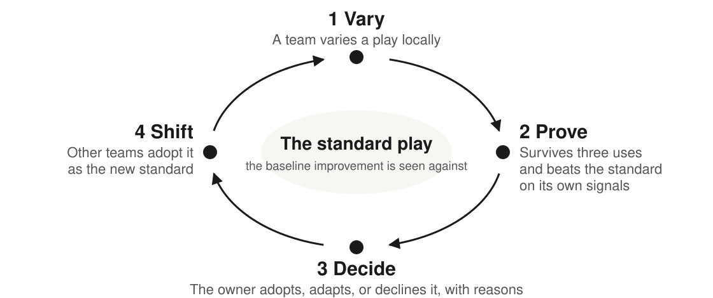

<!-- _class: lead -->
<!-- _paginate: false -->
<!-- _footer: "" -->

# Creating Playbooks

Codifying practice so it transfers, improves, and retires

---

## Most playbooks die one of two deaths

- **The museum piece:** written once and never revised against evidence. Stale plays carry false authority, and every play has the same date on it.
- **The enforcement tool:** made mandatory, with the when-not-to deleted. Teams comply in public and ignore it in private.

Both come from leaving the tension between standardising and improving unresolved.

---

## The standard is the baseline that makes improvement visible

Codification standardises. Improvement requires variation.

Toyota's answer is to treat the standard as a baseline. You cannot see a local improvement without a standard to see it against.

This holds only if every play is provisional and a local improvement can become the new standard cheaply.

---

<!-- _class: steps -->

## A play is a situated action

1. **Entry conditions** The situation the reader is standing in
2. **The action** What to do. Usually the smallest part
3. **Signals** How you would know it is working, within weeks
4. **When not to** Where the play does not apply. Mandatory

When you see these conditions, this action tends to work, and here is how you would know.

---

## Most things called playbooks are something else

Does it break into plays? Does each play say when it applies, when it does not, and how you would know it is working? Does it still need judgement? Any no, and it is a neighbour:

- **Checklist:** items to verify, with no situation
- **Runbook:** deterministic steps, with judgement minimised
- **Methodology:** adopted wholesale, with the when-not-to deleted
- **Values statement:** aspirations without actions or signals

Any of these can be the right tool. Label it honestly.

---

<!-- _class: pairs -->

## Each stage has a play, and the failure it prevents

| Stage | Play | Failure it prevents |
| --- | --- | --- |
| Sense | Notice the third time | Premature codification |
| Extract | Extract from what happened | The espoused playbook |
| Codify | Situate every play | The context-free recipe |
| Publish | Publish before you are confident | The broadcast |
| Format and access | Separate the reading path from the change path | The wizard's tax |
| Govern | Local improvement to new standard | The museum piece |

---

## Extract the play from what actually happened

People describe their espoused theory. What they actually do is their theory in use. The gap is widest where practice is most skilled, because skilled practice has gone tacit.

- Write the instances out raw first, then extract the play from them.
- Keep the failure in. If it took three attempts, that becomes a force in the play.

A real play contains at least one detail you would rather leave out.

---

## A local improvement becomes the new standard

The change path must cost less than the workaround.

---

## Nobody should need wizardry to read or change a play

1. **Default to public.** Make exceptions play by play.
2. **Reading needs only a browser.** Keep the source under version control and the reading path at a stable URL.
3. **Proposing needs no tooling.** A form, an email, or a comment counts.

If the people closest to the work are not the ones proposing changes, it has failed.

---

## Start small, from real instances

1. Start a candidate list today, with one line for each action you keep repeating.
2. Write one play from a real instance, using the template. Put the entry conditions first.
3. Publish before you are confident. The first three uses are the test.

---

<!-- _class: lead -->
<!-- _paginate: false -->
<!-- _footer: "" -->

## Read the full playbook

[profound.fyi/playbooks/creating-playbooks](https://profound.fyi/playbooks/creating-playbooks/)

These slides are a projection. The plays live, and change, at the source.
